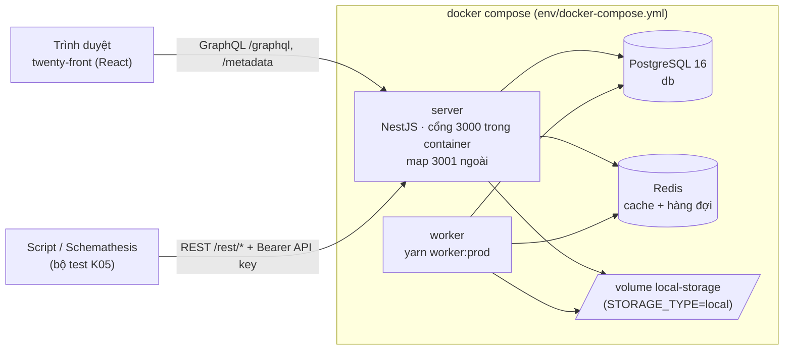
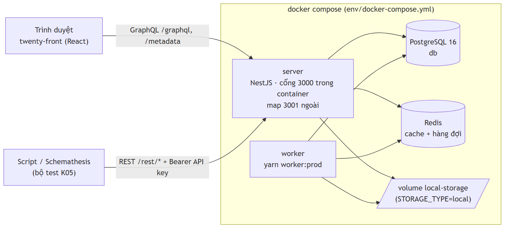
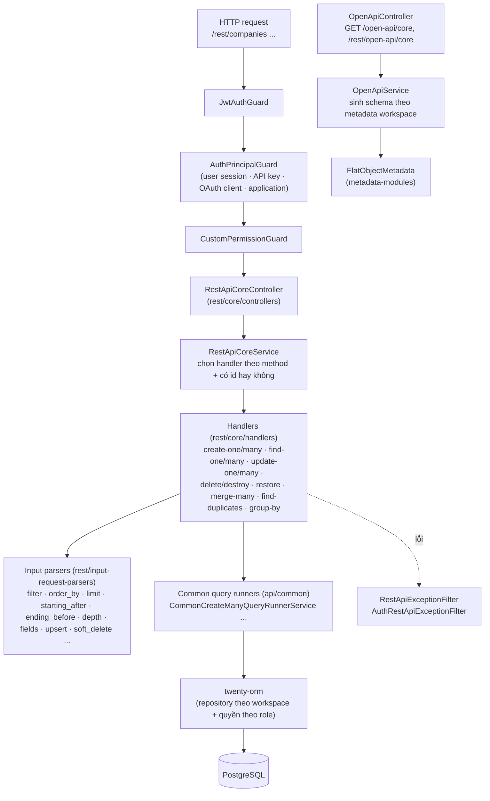
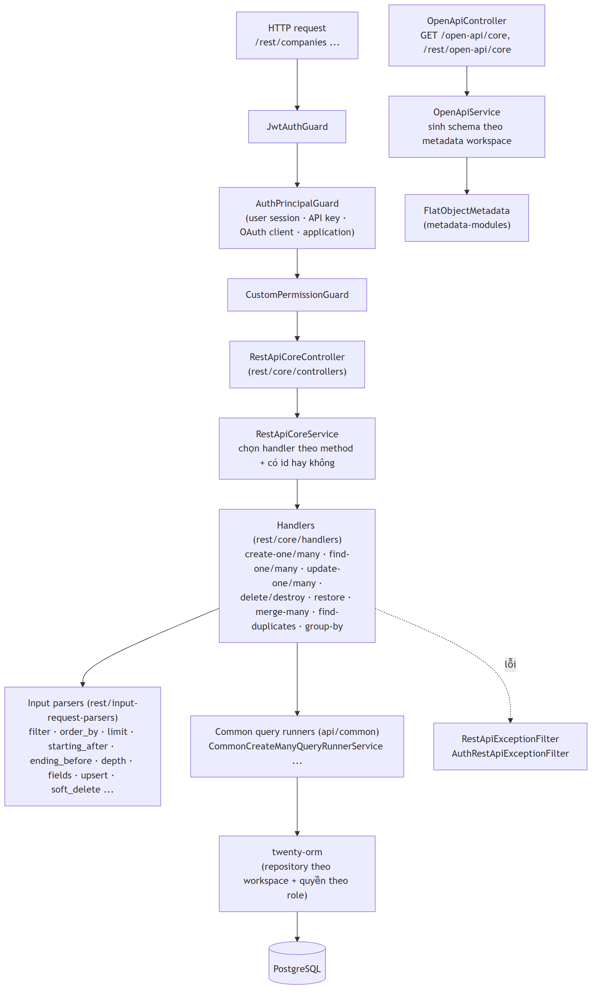
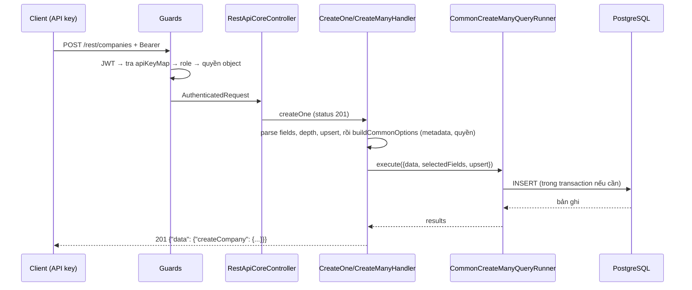
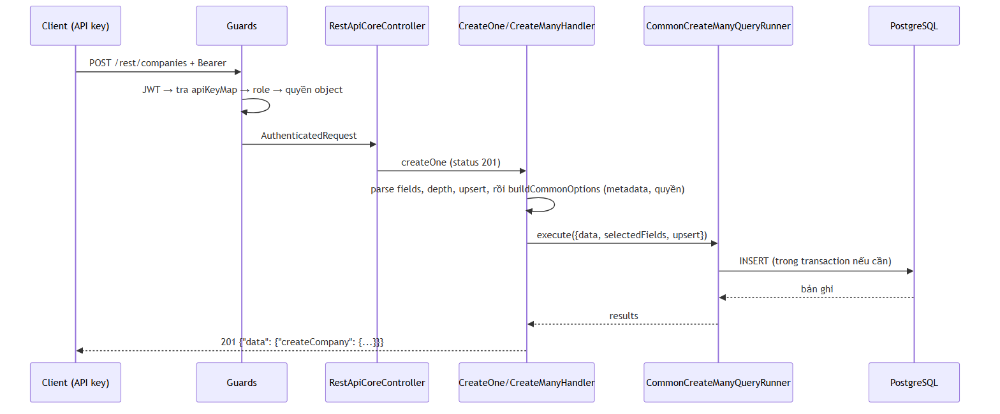
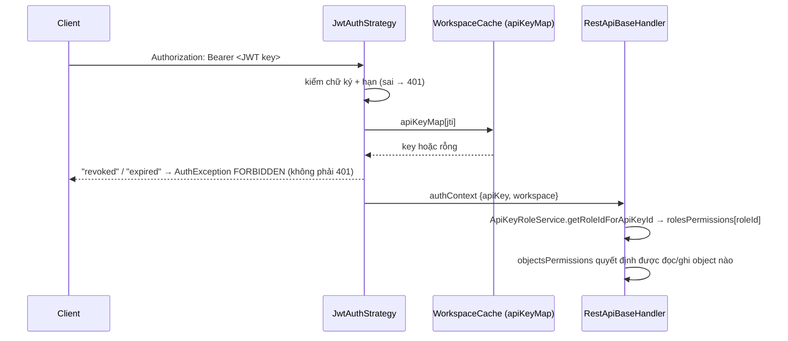
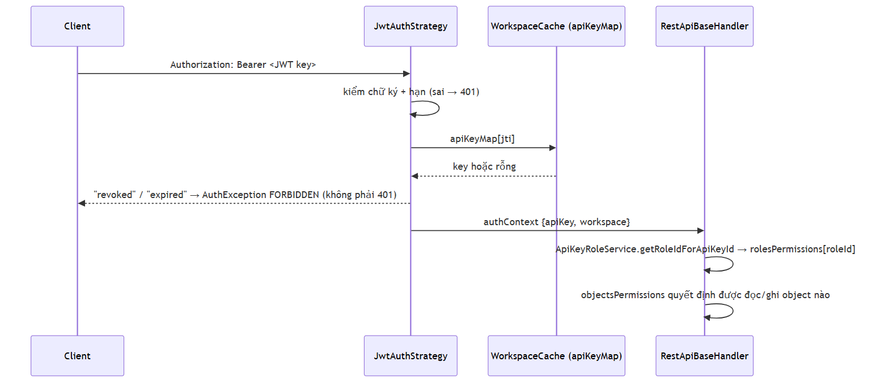

# Phân tích kiến trúc Twenty v2.45.6 (Báo cáo Phần A và B)

Người thực hiện: Thuận. Phiên bản đọc: tag `twenty/v2.45.6`, SHA `6007ad5a7f6cb676fd8a9ff0c2a86a2e3d4c260e`.
Phạm vi: những gì liên quan tới kiểm thử REST API bằng Schemathesis (K05). Các nhận định được đánh dấu **[mã]** là đọc trực tiếp
từ mã nguồn; **[chưa chạy]** là suy ra từ mã, cần xác nhận trên instance thật.

## A. Phân tích hệ thống

### A.1. Mục tiêu hệ thống

Twenty là CRM mã nguồn mở: quản lý Công ty (Companies), Người (People), Cơ hội bán hàng (Opportunities), Ghi chú (Notes),
Công việc (Tasks) và nhiều đối tượng khác. Mô hình dữ liệu **tùy biến theo workspace** (thêm object/field qua Metadata API),
và API (GraphQL + REST + OpenAPI) được **sinh tự động** từ mô hình đó. Chính điều này làm Twenty phù hợp với kiểm thử dựa trên schema.

### A.2. Actor và use case

| Actor | Dùng hệ thống để | Cách truy cập |
|---|---|---|
| Thành viên workspace (nhân viên sales) | Quản lý công ty, người, cơ hội, ghi chú, công việc | Giao diện web `twenty-front` → GraphQL |
| Quản trị workspace | Quản lý object/field, role, API key | Giao diện web (Settings) → Metadata API |
| Hệ thống bên ngoài / script | Đọc ghi dữ liệu tự động | REST `/rest/...` hoặc GraphQL `/graphql` với **Bearer API key** |
| Tiến trình nền (worker) | Chạy job (đồng bộ, workflow, cron) | Hàng đợi Redis + PostgreSQL |
| **Bộ test K05 (nhóm mình)** | Đọc OpenAPI, sinh request, kiểm invariant | REST + Bearer API key |

Use case trọng tâm của đề tài: (UC1) tạo/đọc/sửa/xoá bản ghi qua REST; (UC2) liệt kê có phân trang, lọc, sắp xếp;
(UC3) thao tác hàng loạt (batch); (UC4) xác thực và phân quyền bằng API key; (UC5) lấy OpenAPI schema.

### A.3. Cây thư mục (mức monorepo)

`packages/` gồm: `twenty-server` (backend NestJS), `twenty-front` (React), `twenty-shared` (kiểu và hằng dùng chung),
`twenty-ui`, `twenty-emails`, `twenty-docker` (Compose và image), `twenty-docs`, `twenty-website`, `twenty-e2e-testing`,
`twenty-sdk`, `twenty-client-sdk`, `twenty-cli`, `twenty-apps`, `twenty-zapier`, `create-twenty-app`, `twenty-companion`,
`twenty-front-component-renderer`, `twenty-oxlint-rules`, `twenty-utils`, `twenty-agent-skills`, `twenty-claude-skills`. **[mã]**

Trong `twenty-server/src/` **[mã]**: `main.ts`, `app.module.ts`, `engine/`, `modules/`, `database/`, `command/`, `queue-worker/`, `filters/`, `utils/`.

`twenty-server/src/engine/` **[mã]**:

| Thư mục | Vai trò (theo tên và nội dung đã đọc) |
|---|---|
| `api/` | Tầng API: `rest/` (REST core + metadata), `graphql/`, `mcp/`, `common/` (bộ chạy truy vấn dùng chung), `types/`, `utils/` |
| `core-modules/` | Các module nền: `auth`, `api-key`, `open-api`, `workspace`, `user`, `feature-flag`, `file`, `billing`, `throttler`, `exception-handler`, `message-queue`, `workflow`, `search`... (hơn 70 module) |
| `metadata-modules/` | Quản lý metadata: object, field, role, permission, view, index... |
| `twenty-orm/` | ORM theo workspace (mỗi workspace một schema PostgreSQL) |
| `workspace-manager/` | Khởi tạo workspace, dev-seeder (dữ liệu mẫu), ứng dụng chuẩn (object/field chuẩn như Company, Person, Opportunity) |
| `guards/` | Guard dùng chung (`NoPermissionGuard`, `PublicEndpointGuard`...) |
| `workspace-cache`, `workspace-cache-storage`, `core-entity-cache` | Cache metadata và quyền theo workspace |

### A.4. Dependency giữa thành phần

Nguồn: `packages/twenty-docker/docker-compose.yml` **[mã]**: dịch vụ `server`, `worker` (cùng image `twentycrm/twenty:${TAG}`, lệnh `yarn worker:prod`), `db` (`postgres:16`), `redis`; cổng `3001:3000`; `worker` chờ `db` và `server` khỏe.

## B. Kiến trúc mức component/container và module liên quan test

### B.1. Sơ đồ component của tầng REST trong `twenty-server`

### B.2. Các module liên quan trực tiếp tới kiểm thử

| # | Module (đường dẫn dưới `packages/twenty-server/src/engine/`) | Làm gì | Vì sao quan trọng cho K05 |
|---|---|---|---|
| 1 | `core-modules/open-api/` (`open-api.controller.ts`, `open-api.service.ts`, `utils/`) | Phục vụ `GET /open-api/core` và `GET /rest/open-api/core` (và `metadata`). Endpoint công khai (`PublicEndpointGuard`); **có Bearer key mới có đường dẫn của object**, không thì chỉ khung. Với mỗi object sinh: `/{plural}`, `/batch/{plural}`, `/{plural}/{id}`, `/{plural}/duplicates`, `/{plural}/{id}/restore`, `/{plural}/restore`, `/{plural}/merge`, `/{plural}/groupBy`. `servers[0].url` = `${SERVER_URL}/rest/`. | Đây là **nguồn schema** của Schemathesis; chất lượng schema quyết định chất lượng test |
| 2 | `api/rest/core/` (controller, service, handlers) và `api/rest/rest-api-exception.filter.ts` (bộ lọc lỗi: lỗi không phải `HttpException` mặc định thành 400) | Nhận request REST, chọn handler. Controller có `@Controller('rest')`; route: `POST batch/*`, `POST */duplicates`, `POST *`, `GET */groupBy`, `GET *`, `DELETE *`, `PATCH */restore`, `PATCH */merge`, `PATCH *`, và `PUT *` (**không có trong OpenAPI**) | Đây là **đối tượng bị test** |
| 3 | `api/rest/input-request-parsers/` | Phân tích tham số: `limit`, `filter`, `order_by`, `starting_after`, `ending_before`, `depth`, `fields`, `upsert`, `soft_delete`... | Nơi sinh lỗi 400 và các hành vi biên (SC3) |
| 4 | `api/common/common-query-runners/` | Logic chạy truy vấn dùng chung cho REST và GraphQL; có kiểm tra số bản ghi tối đa | Quyết định giới hạn batch (SC4) |
| 5 | `core-modules/auth/` (`strategies/jwt.auth.strategy.ts`, guards) và `core-modules/api-key/` | Xác thực: API key là **JWT**; strategy tra `apiKeyMap` của workspace, từ chối key bị thu hồi/hết hạn (`FORBIDDEN_EXCEPTION`). `ApiKeyRoleService` ánh xạ key → role | SC5 (xác thực, phân quyền) |

### B.3. Hằng số và giới hạn quan trọng (đọc từ mã) **[mã]**

| Giới hạn | Giá trị | Nguồn |
|---|---|---|
| `limit` mặc định | 60 | `twenty-shared/src/constants/QueryDefaultLimitRecords.ts` |
| `limit` tối đa | 200; vượt thì **cắt về 200, không lỗi**; âm hoặc không phải số → `INVALID_LIMIT_QUERY_PARAM` | `QueryMaxRecords.ts`, `parse-limit-rest-request.util.ts` |
| Batch create/upsert tối đa | 200 bản ghi (`Maximum number of records to upsert is 200.`) | `common-create-many-query-runner.service.ts` dòng ~114 |
| Bản ghi lồng nhau tối đa khi tạo | 200 | cùng file, dòng ~659 |
| Số bản ghi gộp (merge) tối đa | 9 | `MutationMaxMergeRecords.ts` |
| Bản ghi lấy qua quan hệ | 60 | `QueryMaxRecordsFromRelation.ts` |
| Số trường tối đa khi chọn `fields` | 200 | `rest-api-default-max-fields.constant.ts` |

## C. Data flow của 5 nghiệp vụ trọng tâm

### F1. Tạo Company (`POST /rest/companies`)

Handler `RestApiCreateManyHandler` **[mã]** trả `{ data: { create<Plural>: [...] } }`; handler tạo một bản ghi theo cùng mẫu **[chưa chạy]**: khóa phản hồi `createCompany` cần xác nhận khi chạy `scripts/business_flows.py`.

### F2. Liệt kê Companies có phân trang (`GET /rest/companies?limit=..&starting_after=..`)

`RestApiCoreService.get` → không có `id` → `RestApiFindManyHandler`. Phản hồi có `data`, `pageInfo` (`hasNextPage`, `hasPreviousPage`, `startCursor`, `endCursor`) và `totalCount` **[mã: kiểu `FormatResult` trong `rest-api-base.handler.ts`]**. `limit` đi qua `parseLimitRestRequest` (mục B.3).

### F3. Đổi giai đoạn Opportunity (`PATCH /rest/opportunities/{id}` với `{"stage":"MEETING"}`)

`RestApiCoreService.update` → có `id` → `RestApiUpdateOneHandler`; không có `id` → `RestApiUpdateManyHandler` (cập nhật hàng loạt theo filter). Các giá trị `stage` thấy trong dữ liệu mẫu: `NEW`, `SCREENING`, `MEETING`, `PROPOSAL`, `CUSTOMER` **[mã: opportunity-data-seeds.constant.ts]**.

### F4. Xác thực và phân quyền bằng API key

### F5. Lấy OpenAPI schema (`GET /open-api/core`)

`OpenApiController` → `OpenApiService.generateCoreSchema(request)`: lấy `SERVER_URL`, dựng khung `baseSchema('core', baseUrl)`,
**xác định workspace từ request** (nhờ Bearer key); nếu không có workspace hoặc không có object thì trả khung rỗng; nếu có thì
với mỗi `FlatObjectMetadata` sinh các đường dẫn ở B.2 mục 1. **[mã]**

(Luồng Notes/Tasks theo cùng khuôn F1–F3 vì dùng chung handler; chỉ khác metadata object.)

## D. Hệ quả cho thiết kế test K05

| Mã | Phát hiện | Việc phải làm |
|---|---|---|
| H1 | `limit>200` bị cắt âm thầm | Ca P3-05/06 trong `probe_boundaries.py`; nếu schema khai báo `maximum`, đây là "lệch schema" cần phân loại |
| H2 | Batch tối đa 200, không phải 60 | SC4 dùng 0/1/200/201 (+61 đối chứng) |
| H3 | Lỗi nội bộ có thể hiện thành 400 | Đọc nội dung lỗi, không chỉ mã trạng thái |
| H4 | `PUT *path` không có trong OpenAPI | Ghi nhận khi `unsupported_method` báo |
| H5 | Key hỏng cho 401, key thu hồi/hết hạn cho 403 | SC5 chấp nhận cả hai, ghi từng ca |
| H6 | Quyền theo role của key | Cần key role giới hạn (Trung) |
| H7 | Schema đổi theo metadata workspace | Lưu bản chụp `schema/core.openapi.json` kèm commit |

## E. Việc còn phải làm trên instance thật

- Chạy `scripts/business_flows.py` để xác nhận khóa phản hồi (`createCompany`...) và 3 luồng.
- Đo giới hạn tốc độ thật (SPEC ghi 100 req/phút, chưa kiểm chứng).
- Đọc thêm `rest-api-create-one.handler.ts`, `rest-api-update-one.handler.ts`, `rest/metadata/` nếu mở rộng sang Metadata API.
- Vẽ lại hai sơ đồ Mermaid thành hình (draw.io) cho slide nếu thầy yêu cầu.
